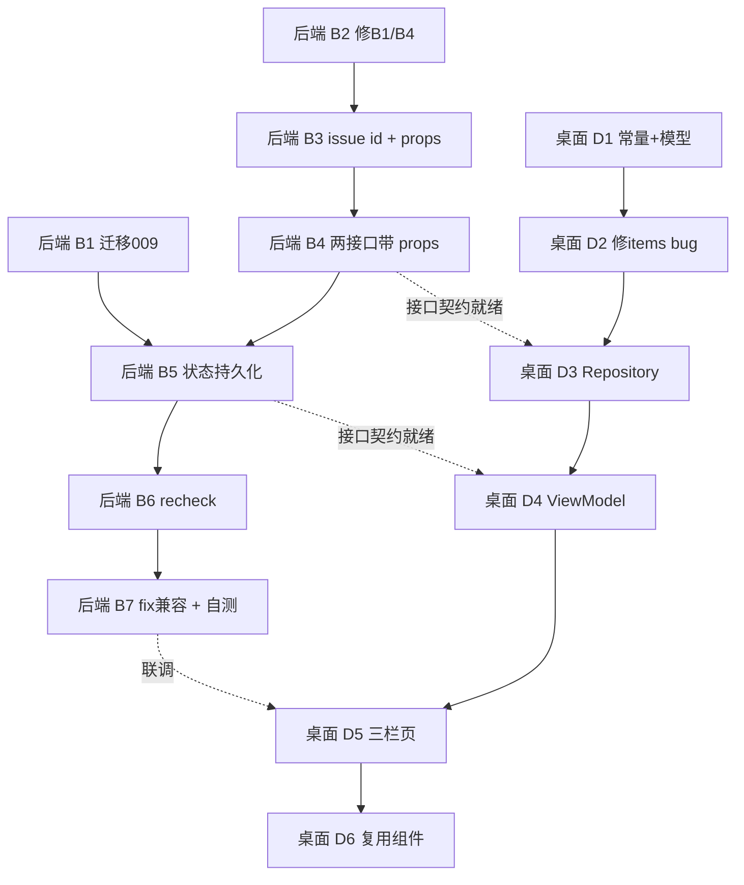

# 公文格式审校工作台 · 增量设计

> 版本：v3.4 · **rev.4（已按 team-lead 15 项裁定收敛；★接口以 `apply`/`undo` 为准）**
> 前置侦察：**`docs/format-check-capability-audit.md`**（能力清单、issue 结构、接口现状、gap 与既有缺陷 B1–B4）——本文不重复其内容，凡引用处直接指向该文档。
> 依据：team-lead 决策 1–7；**7 项遗留争议的裁定见 §9**。
> 本轮**只写文档，不写实现代码**（后端与 Kotlin 均不写）。
>
> **rev.2 相对 rev.1 的变更**（只改受裁定影响的段落，未重写）：
> 1. 状态列 5 → **2**（砍 `applied_at` / `ignored_ids` / `revoked_ids`），`Modification` 去掉 `appliedAt`；
> 2. 四态 → **三态**（待处理 / 已应用 / 已修正）；
> 3. B4 改按**实测**结论写（表里确有 `ruleset` 列）→ 补 ORM 映射；并追加 `run_all` 不得静默吞异常；
> 4. recheck `use_ai=false` 补上**运行事实理由**（8001 vLLM 当前不可用）；
> 5. `issue_count` 语义**不改**，新增派生 `open_issue_count` 写进全部相关契约；
> 6. §6.3 新增「发布前必须完成的迁移全链验证」（硬性要求 + 回退方案留痕）；
> 7. §4.5 新增 `delete_paragraph` **位移补偿**专节（含伪代码与误判示例）。
>
> **rev.3 相对 rev.2 的变更**：① 迁移目录路径加了实测校正（`server\app\migrations\versions\`，并点明 `alembic.ini` 的 `script_location` 是相对路径、命令必须在 `server\` 下跑）；② §2.2b 新增存量记录惰性补 id 的四条硬约束；③ §10 改为「已知行为与已决定设计」，原三条待确认全部移出；④ 新发现并修掉缺陷 **B5′（`rule_snapshot` 漏存 `severity`）**。
>
> **rev.4 相对 rev.3 的变更（★ = 契约 authoritative）**：① §3.3/§3.4 改为 **`POST /apply` + `POST /undo`** 单项端点，取代原 `PUT /applied`；② 新增 **§3.6b 本轮接口总表**（唯一权威清单）；③ 新增 **§3.9「非本轮实现」**，把 `PUT /applied` 与 `GET /modifications` 明确标注为未来可选扩展；④ `recheck` 补 `skipped_reason`；⑤ §2.4 澄清 `Modification` 是**客户端派生**、服务端不下发；⑥ §8 增 17/18 两条；⑦ **§11 清空**（全部条目已有结论，附去向表）。

---

## §1 背景与目标

### 1.1 起点（详见 audit）

| 维度 | 现状（audit 结论） |
|---|---|
| 检测 | 12 项规则类检查项全覆盖，`checks` 为 JSON 可配；线上 21 条默认规则（audit §①） |
| 自动修改 | 12 项中 11 项已实现，python-docx 直接改 run/paragraph 属性（audit §②） |
| 缺口 | G1 issue 无 id、G2 无任何接口返回格式属性、G3 无已应用状态持久化、G4 无重新校验（audit §⑧） |
| 缺陷 | B1 首行缩进单位不一致（应用后复检必报错）、B4 seed 引用 ORM 不存在的 `ruleset`（audit §⑧-C） |
| 关键性质 | `apply_fixes()` 永远是「原始文档 + 已接受集合」全量重放 → **撤销天然成立，不需要反向操作** |

### 1.2 目标

把「格式校验」页做成三栏审校工作台，支撑完整闭环：
上传 → 得到真实问题 → 定位原文 → 查看修改前 → 应用修改 → 文档真实变化 → 查看对比 → 撤销 → 再次应用 → 多修改中单独撤销 → 切换修改前/当前版本 → 重新校验 → 导出修正稿 → **原始文件保持不变**。

### 1.3 本轮决策（team-lead 已拍板，不再论证替代方案）

| # | 决策 |
|---|---|
| 1 | 段落对象统一带排版属性 `props`，**一个字段集同时解决"公文纸渲染"与"修改前后对比"**；`/paragraphs` 与 `/preview-fix` 返回同一结构；向后兼容（只增字段） |
| 2 | 采纳方案 B（按集合重放）；`Modification` 为**派生视图不落库**；只持久化已应用集合 |
| 3 | 重新校验 = `POST /records/{id}/recheck`，**同 record 内收敛，不生成新 record**；已修正的问题**不从列表消失** |
| 4 | B1、B4 本轮一并修 |
| 5 | 迁移编号 **009**（008 已存在），`down_revision = "008_v33_user_preferences"` |
| 6 | **翻页 `< 1 / 5 >` 砍掉**（后端无页码、python-docx 拿不到真实分页，硬算=假功能）；改连续滚动 + 定位滚动，缩放保留 |
| 7 | 桌面端 `FormatCheckRepository.paragraphs()` 用 `items()` 取 `paragraphs` 永远为空 —— 一并修 |

---

## §2 数据模型

### 2.1 `format_check_records` 新增字段（迁移 009）

**迁移文件落点（实测路径，勿写成 `server\alembic\versions\`，该目录不存在）**：

```
server\alembic.ini                                          ← 配置文件（alembic 命令的 cwd）
server\app\migrations\versions\009_v34_format_check_workbench.py   ← 本次新增
```

`alembic.ini:2` 的 `script_location = app/migrations` 是**相对路径**，所以 `alembic` 必须在 `server\` 下执行；versions 目录真实位置是 `server\app\migrations\versions\`（现有最新为 `008_v33_user_preferences.py`）。详见 §6.3 路径校正。

`revision = "009_v34_format_check_workbench"`，`down_revision = "008_v33_user_preferences"`
风格沿用 `007/008`：inspector 守卫 + `server_default`，保证 SQLite 存量库可平滑加列。

**状态列只落 2 列**（team-lead 最终裁定）：

| 列 | 类型 | 默认 | 用途 |
|---|---|---|---|
| `applied_ids` | JSON | `[]` | **核心状态**：当前已应用的 issue id 集合（全量重放的唯一输入） |
| `resolved_ids` | JSON | `[]` | 最近一次 recheck 判定"该问题已不存在"的 id；**每次 recheck 全量重算** |
| `updated_at` | DateTime | `now` | 决策 5 原有，非状态列；随每次 apply / undo / recheck 更新 |

**已被砍掉的 4 列（理由：死列比缺列更难收拾——后来者会把它当成"已有能力"去依赖；缺列将来加一个迁移就能补）**

| 砍掉的列 | 原因 |
|---|---|
| `applied_at` | 本轮 UI 无任何地方展示"修改时间" → `Modification.appliedAt` **一并从契约中移除** |
| `ignored_ids` | 本轮桌面端**没有"忽略"入口**（v3.1 原型里有，本轮规格没要）→ 等真做时上 010 |
| `revoked_ids` | 重放语义上等价于 pending，只驱动徽标 → 撤销后回落显示「待处理」（见 §4.2 三态） |
| ~~`pass_no`~~ | 本就未列入；无对应用户需求 |

> 相对决策 5 的差异：列名 `applied_indices` → **`applied_ids`**（理由见 §2.3）。状态列从 5 个降为 2 个。

### 2.2 issue 补 id（一处落库）

落点：`server/app/application/format_check/service.py` `check_upload()`，在 `issues = result["issues"]`（:96）之后、`self.records.add(...)`（:97）之前：

```python
issues = [
    {**it, "id": f"{record_id_prefix}#{i}"}     # 见下方 id 规则
    for i, it in enumerate(issues)
]
```

**id 规则**：`f"{record.id}#{i}"`。因 `record.id` 在 `records.add()` 之后才拿到，需先 `uuid` 预生成或改用**两段式写入**：
- 推荐：`issues` 先按 `f"r#{i}"` 占位 → `records.add()` 拿到 `record.id` 后一次性改写为 `f"{record.id}#{i}"` 再 `commit`。
- 或：`IdMixin` 的 id 由 `default=generate_uuid` 生成，可在 `add()` 前显式构造 `FormatCheckRecord(id=str(uuid.uuid4()), ...)`，然后直接用该 id 拼 issue id。**推荐后者**（一次成型，无二次写库）。

### 2.2b 存量老记录的惰性补 id（team-lead 裁定：采纳「首次 GET 时补 + 写回」）

存量记录（线上 3 条）的 `issues` 里没有 `id`。处理方式是**首次读取时惰性补齐并写回**，不是一次性 migration 脚本，也不是下发时才临时拼。

```python
def _ensure_issue_ids(record) -> bool:
    """返回 True 表示本次发生了写回。"""
    if all(isinstance(i, dict) and i.get("id") for i in (record.issues or [])):
        return False
    record.issues = [
        {**it, "id": f"{record.id}#{i}"} for i, it in enumerate(record.issues or [])
    ]
    record.applied_ids  = record.applied_ids  or []     # 不能是 NULL
    record.resolved_ids = record.resolved_ids or []     # 不能是 NULL
    return True
```

**四条硬约束**

1. **补 id 的规则必须就是 `enumerate(issues)` 的下标**，与新增记录（§2.2）**完全一致**，不得另立一套（如按 hash / 按 element 拼）。否则同一条记录里会混两种 id 语义。
2. **同时把 `applied_ids` / `resolved_ids` 初始化为 `[]`**，**不能留 NULL** —— 前端解析 `null` 集合会崩；`open_issue_count = len(issues) - len(resolved_ids)` 也会 TypeError。
3. **写回必须记一条 info 日志**：`logger.info("backfill issue ids: record=%s, count=%d", record.id, n)`。将来排查"这条记录的 id 为什么是后补的"时要有据可查。
4. 调用点：`get_record()` / `get_record_paragraphs()` / `modifications()` 三个入口统一走 `_ensure_issue_ids`，写回后 `commit`。

### 2.3 为什么用 id 而不是纯下标

`recheck` 后 `issues` 会新增条目（§4.4）。若 `issues` 允许重排/压缩，纯下标引用会错位。本设计把 `issues` 定为 **append-only**（只增不删），因此 `id` 中的序号与数组下标**恒等**；用 id 是为了让引用**自解释**、前端可直接当 key，且将来若引入去重/压缩时语义不崩。

### 2.4 `Modification` 派生视图（不落库、**不下发**）

由 `issues × applied_ids × resolved_ids` 计算，**不建表**（避免与 `issues` 双写漂移）。

> ⚠️ **本轮它也不是接口产物**：`Modification` 只是**客户端的概念模型**——桌面端拿 `issues` + `applied_ids` + `resolved_ids` 在本地算出这个结构用于渲染。
> **服务端没有 `GET /modifications` 接口**（§3.9、§8-17）。本节描述的是客户端派生出来的样子，不是某个响应体。

```python
Modification = {
  "issueId":   "b01dd2fe…#12",            # 稳定 id
  "location":  "第3段（一级标题）",          # 来自 issue.location（人类可读）
  "type":      "paragraph",               # issue.fix_hint.type
                                          # ∈ {page, paragraph, trim_text, delete_paragraph}
                                          # AI 类（fix_hint=null）→ "manual"
  "element":   "字号",                     # issue.element（中文检查项名）
  "before":    "黑体 · 三号",               # issue.current（_fmt_value 已格式化）
  "after":     "方正小标宋简体 · 二号",       # issue.expected
  "applied":   true,                      # issueId ∈ applied_ids
  "state":     "applied",                 # 派生，三态，见 §4.2
  "fixable":   true,                      # fix_hint 非空
  "severity":  "error",
  "source":    "rule",
}
```

- `before` / `after` 已存在于 `issue.current` / `issue.expected`（audit §③），**无需新增字段**。
- **`appliedAt` 已从契约中移除**：随 `applied_at` 列一起砍掉（本轮无展示需求、无存储），不是"暂不返回"。

---

## §3 接口契约

统一前缀 `/api/v1`。除 rules CRUD 用 `require_admin_or_above`，其余 `Depends(get_current_user)`；记录级访问沿用 `get_record_checked()`（`service.py:135-141`，本人或 `ADMIN_OR_ABOVE`）。

### 3.1 改动：`GET /format-check/records/{id}/paragraphs`

**方法** GET ｜ **幂等** 是（只读）

**响应 200**

```json
{
  "record_id": "b01dd2fe…",
  "filename": "××函.docx",
  "paragraphs": [
    {
      "index": 0, "text": "广州市白云区司法局关于…的函",
      "align": "center", "indent_chars": 0.0, "is_heading": true,
      "bold": false, "font_name": "黑体", "font_pt": 16.0,
      "line_spacing": 28.8, "space_before_pt": 0.0, "space_after_pt": 0.0
    }
  ],
  "page": {
    "top_margin_cm": 2.54, "bottom_margin_cm": 2.54,
    "left_margin_cm": 3.17, "right_margin_cm": 3.17,
    "page_width_cm": 21.0, "page_height_cm": 29.7
  }
}
```

| 字段 | 来源 | 说明 |
|---|---|---|
| `index` / `text` | 现有 | **保留，向后兼容** |
| `align` | `p.alignment` | `left/center/right/justify`；未显式设置按 `left`（与检测口径 `:267` 一致） |
| `indent_chars` | **新增共享 helper** `_first_line_indent_chars(p)`（§5.1） | **与检测、修正同口径** |
| `is_heading` | 首个非空段落=标题，或命中 `_RE_H1`/`_RE_H2`（`:39-40`） | boolean |
| `bold` / `font_name` / `font_pt` | 段内**首个非空 run**（与检测 `:230` 同口径） | `font_name` 优先 `w:eastAsia`（`:44-56`） |
| `line_spacing` | `pf.line_spacing.pt`，倍数值时为 `null` | 磅 |
| `space_before_pt` / `space_after_pt` | `pf.space_before/after.pt` | 可为 `null` |
| `page` | `doc.sections[0]` | 供页边距/页面尺寸对比；**这是段落级 props 覆盖不到的部分** |

**错误码**：`400` 非 docx（`_get_record_docx`）｜`403` 无权限｜`404` 记录不存在｜`410` 源文件已过期

### 3.2 改动：`POST /format-check/preview-fix`

**方法** POST ｜ **幂等** 是（同输入同输出；**不写库**）

**请求体**（三选一，服务端统一归一化为 id 集合）

```json
{ "record_id": "…", "applied_ids": ["…#12", "…#13"] }
{ "record_id": "…", "applied_indices": [12, 13] }     // 兼容旧字段
{ "record_id": "…", "accepted_indices": [12, 13] }    // 兼容桌面端现有调用
```

**响应 200**

```json
{
  "paragraphs": [ { /* 与 §3.1 完全相同的 enrich 结构 */ } ],
  "page":       { /* 与 §3.1 相同 */ },
  "applied_count": 2
}
```

**向后兼容**：`paragraphs[i]` 仍含 `index`/`text`，旧客户端只取这两字段不受影响。
**副作用**：覆盖写 `{DATA_DIR}/format-check/{id}_preview.docx`（与现状一致）。
**语义不变**：仍从**原始** `{id}.docx` 重放，不是在当前稿上叠加。

### 3.3 新增：`POST /format-check/records/{id}/apply`　★本轮主契约

**方法** POST ｜ **幂等** 是（重复应用同一 id，集合不变 → 结果一致）

**请求体**

```json
{ "issue_id": "…#12" }
```

**响应 200**

```json
{
  "record_id": "…",
  "applied_ids": ["…#12","…#13"],
  "resolved_ids": [],
  "open_issue_count": 4,
  "paragraphs": [ { /* 应用后的 enrich 结构，与 §3.1 相同 */ } ],
  "page": { /* 应用后 */ }
}
```

**服务端行为**：校验 `issue_id` 存在于 `record.issues` → `applied_ids` 加入该 id（**已在集合中则无副作用**）→ 写 `updated_at` → 重放生成当前稿 → 返回。

> **不回 `issues`** —— `issues` 是 append-only，apply 不会改变它，没必要让客户端重新拉一遍。

**错误码**：`400` 未知 issueId / 非 docx ｜`403` ｜`404`

### 3.4 新增：`POST /format-check/records/{id}/undo`　★本轮主契约

**方法** POST ｜ **幂等** 是（撤销一个未应用的 id，集合不变 → 结果一致）

**请求体**

```json
{ "issue_id": "…#12" }
```

**响应 200**：与 §3.3 **完全同构**（`applied_ids` / `resolved_ids` / `open_issue_count` / `paragraphs` / `page`）

**服务端行为**：`applied_ids` 移除该 id → 写 `updated_at` → **从原始稿重放**（不是反向操作）→ 返回。

- 撤销单项 = 该 id 出集合，**其余 id 不动** → 其他修改保持 ✅
- **撤销全部 = 客户端循环调 undo，或把 `applied_ids` 置空**；本轮桌面端按"清空集合 + 拉一次 preview-fix"实现，不需要专门的 `undo-all` 端点。
- **没有 `revoked_ids`**：撤销后该 id 不在 `applied_ids` 里，状态直接回落 `pending`（§4.2），重放语义完全等价，逻辑零影响。

> **不回 `issues`** —— 同 §3.3。

**错误码**：`400` 非 docx ｜`403` ｜`404`（**未知 issueId 不报错**，移除不存在的元素本就是空操作；与 apply 的区别是 apply 必须校验存在，否则会把垃圾 id 写进集合）

### 3.5 新增：`POST /format-check/records/{id}/recheck`　★本轮主契约

**方法** POST ｜ **幂等** **否**（推进校验轮次并写库）

**请求体**

```json
{ "use_ai": false }
```

> `use_ai` 默认 `false`，且 **AI 类 issue（`source == "ai"`）不参与 `resolved_ids` 判定**。两条理由：
> 1. 语义：不跑 AI 却把 AI 问题判成"已修正"，是假的（AI 类无 `paragraph_index`，只能按 `element+expected` 匹配，误判风险高）；
> 2. **现实**：8001 端口的 vLLM 当前是断的（server 日志有 `upstream connect failed`），recheck 跑 AI 只会失败。
> 若将来要支持 `use_ai=true`，需同时定义 AI issue 的匹配键，另开一轮。

**服务端流程**

1. `_get_record_docx()` 校验 docx 与源文件存在；
2. **生成"当前稿"**：`applied_ids` 为空 → 直接用原始 `{id}.docx`；否则 `apply_fixes(原始, issues, applied_ids→下标, out={id}_current.docx)`（**与 `/preview-fix` 同一函数，同一重放语义**）；
3. 用 **`record.rule_snapshot`**（首次校验时的规则快照，保证口径一致）重跑引擎 → `new_issues`；
   - **快照可用（已核实）**：`service.py:99-100` 在 `check_upload()` 里**无条件写入**，`rule_snapshot` 不会为 NULL（老记录同样有值）；
   - ⚠️ **但快照漏了 `severity`**（见 §5.3），recheck 新增的问题会一律降级/升级成 `error` —— **必须一并修**，否则"新增问题"的 severity 与首次校验不一致；
   - 直接复用 `FormatCheckEngine.check_file()`（它已按后缀分派，docx 走 `_check_docx`）；如需更纯粹可在 service 内加 3 行私有 `_run_engine(path, filename, rules, use_ai)` 薄封装 —— **可选，非必需**；
4. **收敛匹配**（§4.4）：算 `resolved_ids`、挑出新问题；
5. `issues` **append-only** 追加新问题（老条目 index/id 不变），更新 `issue_count / rule_issue_count / ai_issue_count`——**语义保持"累计总问题数"不变**（§4.6）；
6. 写 `resolved_ids`（全量重算）、`updated_at`。

**响应 200**

```json
{
  "record_id": "…",
  "issues": [ /* 全量：老条目 + 本次新增，append-only */ ],
  "issue_count": 9, "open_issue_count": 4,
  "new_issue_count": 1, "resolved_count": 3, "still_open_count": 1,
  "applied_ids": ["…#12","…#13"],
  "resolved_ids": ["…#12","…#13","…#7"],
  "paragraphs": [ { /* 当前稿的 enrich 结构 */ } ],
  "page": { /* 当前稿 */ }
}
```

| 字段 | 含义 |
|---|---|
| `issues` | **recheck 唯一回 `issues` 的接口**（因为只有它会新增条目）；apply / undo 不回 |
| `issue_count` | **累计总问题数**（含已修正），语义与现状一致，不破坏 `/records` 列表 |
| `open_issue_count` | **派生**，= `len(issues) - len(resolved_ids)`，不落库 |
| `resolved_count` | 本次 recheck 判定为已修正的数量 |
| `still_open_count` | 已应用但复检仍存在的数量 |
| `applied_ids` / `resolved_ids` | 回传权威集合，客户端直接覆盖本地状态，不自行推导 |

**`skipped_reason`（ai_only 记录）**

`ai_only` 记录（`rule_snapshot` 为空数组、issues 全 `source=="ai"`）在 `use_ai=false` 下必然 `resolved_count=0 / new_issue_count=0`。此时**必须**返回：

```json
{ "skipped_reason": "ai_only_record" }   // 并存于 200 响应；其余字段仍照常返回
```

- 桌面端用**中性色 NoticeBar**（`NoticeBar` 的 info/neutral 档，**不是红色错误条**）显示一句"该记录为纯 AI 校验结果，重新校验不会改变问题列表"。
- 理由：这不是错误，静默返回全 0 会被 QA 当成 bug。

**错误码**：`400` 非 docx ｜`403` ｜`404` ｜`410` 源文件已过期

### 3.6 最小兼容扩展：`POST /format-check/fix`

**不动响应**（仍是 `FileResponse` / `修正稿_{filename}.docx`），仅把 `FixRequest.accepted_indices` 改为**可选**：

```python
class FixRequest(BaseModel):
    record_id: str
    accepted_indices: List[int] | None = None   # 不传 → 用持久化的 applied_ids
```

桌面端现有调用不受影响。

### 3.6b 本轮接口总表（**唯一权威清单**）

| 接口 | 方法 | 状态 |
|---|---|---|
| `POST /format-check/check` | POST | 改（补 issue `id`、快照补 `severity`） |
| `GET /format-check/records` | GET | 改（新增 `open_issue_count`） |
| `GET /format-check/records/{id}` | GET | 改（新增 `open_issue_count`；老记录惰性补 id） |
| `GET /format-check/records/{id}/paragraphs` | GET | **改**（带 props + `page`）★ |
| `POST /format-check/preview-fix` | POST | **改**（带 props + `page`）★ |
| `POST /format-check/records/{id}/apply` | POST | **新增** ★ |
| `POST /format-check/records/{id}/undo` | POST | **新增** ★ |
| `POST /format-check/records/{id}/recheck` | POST | **新增** ★ |
| `POST /format-check/fix` | POST | 改（`accepted_indices` 改可选） |
| rules CRUD | — | 不动 |

**★ = 本轮主契约，后端与桌面端已按此实现。** 清单之外的接口一律未实现（见 §3.9）。

### 3.7 明确不动

| 接口 | 说明 |
|---|---|
| `POST /format-check/check` | 除已补的 `id`（与 `record_id` 同值）外不动；**另需按 §2.2 给每个 issue 补 id** |
| `GET /format-check/records` | 不动；**仅新增派生字段 `open_issue_count`**（见下） |
| `GET /format-check/records/{id}` | 不动（老记录缺 id 时按下标补）；**同样新增 `open_issue_count`** |
| rules CRUD | 不动 |

### 3.7.1 派生字段 `open_issue_count`（不落库、不加列）

```python
open_issue_count = len(record.issues) - len(record.resolved_ids)
```

- 出现在：`GET /records` 列表项、`GET /records/{id}` 详情、`POST /apply`、`POST /undo`、`POST /recheck` 响应。
- **`issue_count` 语义保持不变**（累计总问题数）——它是 `/records` 列表与桌面端 StatCard 在消费的既有语义，改成"未解决数"属隐性破坏。未解决数一律走 `open_issue_count`。

### 3.8 不新增：`GET /records/{id}/paragraph-properties`

按决策 1 **合并进 `/paragraphs`**（§3.1），因此**不新增该接口** —— 少一个端点、少一次往返、前端只需维护一种段落结构。

### 3.9 ⚠️ 非本轮实现（**仅为未来可选扩展，不要当成已有能力**）

> 以下两个接口**本轮不实现**，后端与桌面端**均不存在**。列在这里只是为了记录"当初考虑过"，**后来者不要假定它们可用**。

| 接口 | 原设计意图 | 为什么不实现 |
|---|---|---|
| `PUT /format-check/records/{id}/applied` | 一次性**全量覆盖** `applied_ids`，批量应用/撤销走一个请求 | 本轮拆成 `apply` / `undo` 两个**单项**端点，语义更直白、与 UI 的"点一个按钮改一项"一一对应；批量场景（撤销全部）由客户端清空集合 + 拉一次 `preview-fix` 解决，不需要第三个端点 |
| `GET /format-check/records/{id}/modifications` | 服务端下发 `Modification[]` 派生视图（含 `before`/`after`/`state`） | **与设计前提冲突**：`Modification` 定位就是"派生视图、不落库"。服务端再算一遍下发，等于把派生视图**重新实体化**；客户端已能用 `applied_ids` / `resolved_ids` + `issues` 本地派生三态，多一个端点只是多一处可能漂移的副本（见 §8-17） |

**若将来要加**：先确认是否出现了"客户端派生算不动"的真实场景，不要因为"接口看起来更完整"就补。

---

## §4 状态机

### 4.1 唯一持久状态 = 两个 id 集合

```
applied_ids   ← POST /apply 加一项、POST /undo 去一项（撤销全部 = 清空）
resolved_ids  ← POST /recheck 全量重算
```

> 集合语义不变：**只存"当前已应用了哪些"，从来没有"增量修改"落库**。
> 文档永远 = 原始 docx + `applied_ids` 重放的结果 —— 这是撤销天然成立、且"撤销一个不影响其他"的根本原因。

**没有任何"增量修改"落库。文档永远 = 原始 docx + applied_ids 重放的结果。**

### 4.2 三态派生规则（互斥，按序判定）

| 状态 | 判定 | 含义 |
|---|---|---|
| **已修正** `resolved` | `id ∈ applied_ids` **且** `id ∈ resolved_ids` | 已应用，且最近一次 recheck 确认该问题已不存在 |
| **已应用** `applied` | `id ∈ applied_ids` 且 `id ∉ resolved_ids` | 已应用；尚未复检或复检仍存在 |
| **待处理** `pending` | `id ∉ applied_ids` | 未应用；**撤销后即回落到此态** |

> 原设计的「已撤销」与「已忽略」两态**已砍掉**：
> - 已撤销 ≡ 不在 `applied_ids` 里，与 `pending` 在重放语义上完全等价 → 撤销后直接显示「待处理」，**逻辑零影响**；
> - 已忽略本轮桌面端没有入口 → 不在本轮实现，将来做时上迁移 010。

### 4.3 操作 → 集合变更

| 操作 | 集合变更 | 文档效果 |
|---|---|---|
| 应用单项 | `applied_ids += [id]` | 重放后该项生效 |
| 撤销单项 | `applied_ids -= [id]` | 重放后该项**回到原始状态**（因为是从原始稿重放，不是反向操作）；状态回落 `pending` |
| 应用多个 | 批量 `+=`（一次 PUT 全量覆盖） | 全部生效 |
| 单独撤销其中一个 | `applied_ids -= [id]`，其余**不动** | 只有该项回退，**其他修改保持** ✅ |
| 撤销全部 | `applied_ids = []` | 文档 == 原始文档 |

**"撤销后其他修改保持"这一条由重放语义天然保证** —— 不需要任何额外机制，也不需要额外的状态列。

### 4.4 recheck 收敛算法

```
new = 引擎跑"当前稿"得到的 issues
old = record.issues（append-only，含 id）

# 1) 段落位移补偿：已应用的 delete_paragraph 会让后续段落下标前移
offset(p) = |{ applied issues with fix_hint.type == "delete_paragraph" and paragraph_index < p }|

# 2) 匹配键（定位 + 期望值）
key(i) = (i["element"], str(i["expected"]),
          None if i["paragraph_index"] is None else i["paragraph_index"] - offset(i["paragraph_index"]))

# 3) 只收敛 source=="rule" 的问题（默认 use_ai=false 时 AI 类不参与，避免"AI 没跑就说已修正"）
old_rule = [i for i in old if i["source"] == "rule"]
new_keys = {key(i) for i in new}
resolved_ids = { i["id"] for i in old_rule
                 if i["id"] in applied_ids and key(i) not in new_keys }

# 4) 新出现的问题 append（老条目 index/id 永不变）
old_keys = {key(i) for i in old}
added    = [i for i in new if key(i) not in old_keys]
issues   = old + [带新 id 的 added]
```

**关键点**：
- `issues` **只增不删** → 已修正的问题**不从列表消失**（决策 3 要求），只是 `state` 变成 `resolved`。
- `resolved_ids` **每次 recheck 全量重算**（不是累加）→ 撤销后复检会正确地把 id 移出 `resolved_ids`。

### 4.5 `delete_paragraph` 的段落位移补偿 `offset(p)`

**为什么必须做**：`delete_paragraph`（删除多余空行）应用后，被删段落之后的所有段落下标**整体前移**。若不补偿，recheck 时老的 issue（记录的是**原始稿**下标）与新的 issue（记录的是**当前稿**下标）必然对不上，后果是**一条问题被同时误判成两件事**：

```
原始稿： [0]标题 [1]正文 [2]空行 [3]正文        → 老 issue: "第4段 字号不符"  paragraph_index=3
应用删除空行后：
当前稿： [0]标题 [1]正文 [2]正文                → 新 issue: "第3段 字号不符"  paragraph_index=2

不做补偿 → key(老)=(字号, 三号, 3)  vs  key(新)=(字号, 三号, 2)  → 不相等
         → 老问题被判成"已解决"（进了 resolved_ids）
         → 新问题被当成"新出现"（append 进 issues）
         = 同一条问题在列表里出现两次，还被标成已修正。彻底错乱。
```

**补偿伪代码**：

```python
def _offset(p_idx, issues, applied_ids):
    """p_idx 之前被删掉了几个段落。"""
    if p_idx is None:
        return 0
    return sum(
        1 for i in issues
        if (i.get("fix_hint") or {}).get("type") == "delete_paragraph"
        and i.get("id") in applied_ids
        and (i.get("paragraph_index") or -1) < p_idx
    )

def _match_key(issue, issues, applied_ids):
    p = issue.get("paragraph_index")
    return (
        issue.get("element"),                       # 检查项，如「字号」
        str(issue.get("expected")),                 # 期望值，如「16磅」
        None if p is None else p - _offset(p, issues, applied_ids),   # 位移补偿后的段号
    )
```

**适用范围**：
- `paragraph_index is None` 的问题（页面级、AI 级）不补偿，匹配键前两维即可；
- 只有 `fix_hint.type == "delete_paragraph"` **且已应用**的 issue 参与计数 —— 未应用的删除不算（当前稿没删）。

**这条是"撤销后其他修改保持"能成立的前提之一**：只有下标对齐了，集合里删掉一项才不会连带把别的问题判成已解决/新出现。

### 4.6 `issue_count` 语义（不改）

- `issue_count` **保持"累计总问题数"**（`len(issues)`），不改成"未解决数"—— 它是 `/records` 列表与桌面端在消费的既有语义，改了属隐性破坏。
- 未解决数一律走**派生字段** `open_issue_count = len(issues) - len(resolved_ids)`，见 §3.7.1。

### 4.7 「修改前 / 当前版本」切换（纯前端）

| 视图 | 数据源 |
|---|---|
| 修改前 | `GET /records/{id}/paragraphs` + `page`（**原始稿**） |
| 当前版本 | `POST /preview-fix`（带当前 `applied_ids`）+ `page` |

**切换 = 换一份 props 重新渲染**，文档区排版真实变化（标题变二号、变方正小标宋、居中）。**不翻页**（决策 6），连续滚动 + 定位滚动到指定段落；缩放改 `fontScale` 即可。

---

## §5 缺陷修复（决策 4）

### 5.1 B1 首行缩进单位不一致

**问题**（audit §⑧-B1，源码判定）：检测按 `缩进pt ÷ 字号pt`（`check_engine.py:288-290`），修正写 `Pt(12 × chars)`（`:529`，硬编码 12pt/字符）。正文 16pt、期望 2 字符 → 期望 32pt、实际写 24pt → 复检得 `24/16 = 1.5`，与 2 差 0.5 > 容差 0.3 → **应用后重新校验仍报同一问题**。

**修法：让检测、修正、props 三处共用同一个 helper，并以 Word 原生字符单位为准绳。**

① 新增共享 helper（放在 `check_engine.py`）：

```python
def _first_line_indent_chars(para, font_pt=None):
    """首行缩进（字符数）。三处共用：检测 / 修正 / 段落 props。"""
    ppr = para._p.find(qn('w:pPr'))
    if ppr is not None:
        ind = ppr.find(qn('w:ind'))
        if ind is not None:
            fc = ind.get(qn('w:firstLineChars'))      # Word 原生字符单位，100 = 1 字符
            if fc:
                try:
                    return round(int(fc) / 100.0, 2)
                except (TypeError, ValueError):
                    pass
    pf = para.paragraph_format
    if pf.first_line_indent is not None and font_pt:
        return round(pf.first_line_indent.pt / float(font_pt), 1)
    return None
```

② 检测（替换 `:287-291`）：`cur_chars = _first_line_indent_chars(p, font_pt)`，判定不变。

③ 修正（替换 `:527-535`）：

```python
elif field == "first_line_indent_chars":
    chars = float(value)
    r0 = next((r for r in para.runs if r.text.strip()), None)
    font_pt = (r0.font.size.pt if (r0 is not None and r0.font.size) else None) or 12.0
    pf.first_line_indent = Pt(font_pt * chars)              # 与检测口径一致：字号 × 字符数
    ind.set(qn("w:firstLineChars"), str(int(round(chars * 100))))   # Word 原生单位，权威值
```

④ props `indent_chars` 复用同一 helper。

**为什么这样能自洽**：修正同时写了 `w:firstLine = 字号×chars` 与 `w:firstLineChars = chars×100`。检测**优先读 `w:firstLineChars`**（原生字符单位）→ 精确等于期望值 → 差分 0 → 通过 ✅。同时 `w:firstLine` 也按真实字号计算，只认磅值的渲染器同样正确。
**顺序无关**：字号修正与缩进修正谁先执行都不影响结果，因为 `w:firstLineChars` 是权威值。

### 5.2 B4 seed 引用 ORM 未映射的 `ruleset`（team-lead 裁定：采纳补 ORM 映射）

**实测修正审计结论**：`format_rules` 表**在库里确有 `ruleset` 列**（`004` upgrade 加，`String(30), nullable=True, server_default='gb9704'`；只有 `004` 的 downgrade 才删）。问题不是"字段不存在"，而是 `infrastructure/database/models/format_check.py` 的 `FormatRuleModel` **没有映射它** → `seed_v3.py:176` 的 `FormatRuleModel.ruleset == GBT_RULESET` 抛 `AttributeError`，被 `seed_v3.run_all()` 的 try/except（`:220-225`）吞掉 → **新环境重灌默认规则静默失败，降级成 AI 审查**。

**修法（1 行）：给 ORM 补上映射，不改播种逻辑。**

```python
# models/format_check.py  FormatRuleModel
ruleset: Mapped[Optional[str]] = mapped_column(String(30), nullable=True)
```

- 不改 `_RULE_FIELDS`（`FormatRule` 实体无需该字段，加了反而会 `TypeError`）；
- 不改 `seed_v3.py`；
- 保留"按规则集去重"的语义（`004` 本就设计了这个列），将来要多套规则集直接可用；
- 实测 21 条规则 name 唯一（`COUNT/COUNT(DISTINCT name) = 21/21`），即便退化到按 name 去重也安全。

**配套要求（team-lead 追加）**：`seed_v3.run_all()` 里的 `except Exception` **不得再静默吞异常**，改为 `logger.exception(...)` 并把失败写进返回值（如 `{"format_rules": {"error": "..."}}`）。
理由：这次 B4 之所以潜伏到现在，就是因为异常被吞了。**播种失败必须能被看见。**

### 5.3 B5′ `rule_snapshot` 漏存 `severity`（recheck 引入，本轮新发现）

**问题（源码判定 + 已核实）**：`/check` 写快照时只落 4 个字段（`service.py:99-100`）：

```python
rule_snapshot=[{"id": r["id"], "name": r["name"], "target": r["target"],
                "checks": r["checks"]} for r in rule_dicts]     # ← 没有 severity
```

而 `_rule_to_dict()`（`:26-32`）**是带 `severity` 的**，说明落快照时是**手写字段列表漏了一个**，不是设计如此。

**后果**：引擎取 severity 的写法是 `rule.get("severity", "error")`（`check_engine.py:219 / 240 / 323 / 339`）。recheck 用快照重跑 → 快照里没有 `severity` → **所有新 append 的问题一律 `error`**，即使该规则配的是 `warning`。表现是「重新校验后新增的问题全是红色错误」，与首次校验不一致。

**它会不会影响收敛匹配？不会** —— 匹配键是 `(element, expected, paragraph_index-offset)`，不含 severity。所以这是**展示层失真**，不是收敛错误。

**修法（2 行）**：

```python
# service.py:99-100 —— 落快照时补上 severity
rule_snapshot=[{"id": r["id"], "name": r["name"], "target": r["target"],
                "checks": r["checks"], "severity": r.get("severity", "error")} for r in rule_dicts]
```

```python
# recheck 侧对**老快照**（缺 severity）的兼容
sev = r.get("severity") or "error"
```

**验收**：同一条规则分别为 `warning` / `error` 时，recheck 新增问题的 `severity` 与首次校验一致（见 §7 U-B5）。

---

## §6 有序任务列表

### 后端线（B）

| ID | 任务 | 涉及文件 | 依赖 | 验收点 |
|---|---|---|---|---|
| **B1** | 迁移 009：新增 **2 个状态列**（`applied_ids` / `resolved_ids`）+ `updated_at` | 【新】`server/app/migrations/versions/009_v34_format_check_workbench.py`<br>【改】`server/app/infrastructure/database/models/format_check.py`（ORM 加 3 字段） | — | **必须自带 inspector 守卫**（列不存在才 ADD COLUMN），风格与 005–008 一致；`downgrade` 只删本次 3 列；**并通过 §6.3 的全链迁移验证** |
| **B2** | 修 B4（补 `ruleset` 映射 + `run_all` 改 `logger.exception`）+ 修 B1（helper + 检测 + 修正） | 【改】`server/app/infrastructure/database/models/format_check.py`（`ruleset` 映射）<br>【改】`server/app/application/system/seed_v3.py`（**只把 `except` 改成 `logger.exception` + 返回值带 error**）<br>【改】`server/app/application/format_check/check_engine.py`（新增 `_first_line_indent_chars`；改 `:287-291` 与 `:527-535`） | — | 见 §7 用例 U-B1、U-B1b、U-B4；播种失败时日志可见且返回值含 error |
| **B3** | issue 补 id + **存量记录惰性补 id（§2.2b）** + 段落 props 抽取 + **修 B5′ 快照补 `severity`（§5.3）** | 【改】`server/app/application/format_check/service.py`（`check_upload` 补 id 与快照补 `severity`；新增 `_ensure_issue_ids` / `_paragraph_props(p)` / `_page_props(doc)` / `_enrich(doc)`）<br>【改】`server/app/application/format_check/check_engine.py`（复用 `_first_line_indent_chars`） | B2 | 新记录每个 issue 有 `id`；**老记录首次 GET 时惰性补 id 并写回（`applied_ids`/`resolved_ids` 初始化为 `[]`，记 info 日志）**；写回后 `/paragraphs` 返回全字段 |
| **B4** | 接口改造：`/paragraphs` + `/preview-fix` 带 props | 【改】`server/app/interfaces/format_check.py`<br>【改】`server/app/application/format_check/service.py`（`get_record_paragraphs` / `preview_fix`）<br>【改】`server/app/application/format_check/dto.py`（`FixRequest.accepted_indices` 改可选） | B3 | 两者返回**同一结构**；旧字段 `index`/`text` 仍在 |
| **B5** | 状态持久化：**`POST /apply` + `POST /undo`**（单项，★主契约）+ `open_issue_count` | 【改】`server/app/interfaces/format_check.py`<br>【改】`server/app/application/format_check/service.py`（`apply_issue` / `undo_issue` / `open_issue_count`）<br>【改】`server/app/application/format_check/dto.py`（新增 `IssueActionRequest{issue_id}`）<br>【改】`server/app/domain/format_check/entities.py`（`FormatCheckRecord` 增 `applied_ids`/`resolved_ids`/`updated_at`）<br>【改】`_record_brief` 与 `get_record` 带 `open_issue_count` | B1, B4 | 幂等（重复 apply/undo 同一 id 结果一致）；apply 未知 id → **400** 且不写库；undo 未知 id → 空操作；响应含 `applied_ids`/`resolved_ids`/`paragraphs`/`page`/`open_issue_count`，**不回 `issues`**；`issue_count` 语义未变。<br>**不实现** `PUT /applied` 与 `GET /modifications`（§3.9） |
| **B6** | 重新校验：**`POST /recheck`**（★主契约）+ 收敛算法 + **`offset(p)` 位移补偿** + `skipped_reason` | 【改】`server/app/interfaces/format_check.py`<br>【改】`server/app/application/format_check/service.py`（`recheck` / `_current_docx` / `_offset` / `_match_key`）<br>【改】`server/app/application/format_check/dto.py`（新增 `RecheckRequest{use_ai=false}`） | B5 | 见 §7 用例 U-R1…U-R5；`use_ai=false` 且 AI 类不参与 resolved；**唯一回 `issues` 的接口**；`ai_only` 记录返回 `skipped_reason="ai_only_record"` |
| **B7** | `/fix` 兼容扩展 + 后端自测 | 【改】`server/app/application/format_check/dto.py`、`service.py`<br>【新】`server/tests/test_format_check_workbench.py` | B6 | 不传 `accepted_indices` 时用持久化集合；`pytest` 全绿 |

### 桌面端线（D，可被独立执行）

> 只给契约与落点，不写 Kotlin 实现细节。

| ID | 任务 | 涉及文件 | 依赖 | 契约 / 落点 |
|---|---|---|---|---|
| **D1** | 端点常量 + 数据模型 | 【改】`desktop/src/jvmMain/kotlin/com/judicialai/desktop/core/network/Endpoints.kt`<br>【新】`desktop/.../features/formatcheck/FormatCheckModels.kt` | — | 新增三个端点常量（★主契约）：`fun apply(id)=/format-check/records/$id/apply`、`fun undo(id)=…/undo`、`fun recheck(id)=…/recheck`。<br>模型：`ParagraphProps(index,text,align,indentChars,isHeading,bold,fontName,fontPt,lineSpacing,spaceBeforePt,spaceAfterPt)`、`PageProps(6 个边距/尺寸)`、`ApplyResult(appliedIds,resolvedIds,openIssueCount,paragraphs,page)`。<br>**不建 `Modification` 数据类** —— 三态由 `appliedIds`/`resolvedIds` + issues 本地派生（§8-17） |
| **D2** | **修 `paragraphs()` 取值 bug（决策 7）** | 【改】`desktop/.../features/formatcheck/FormatCheckRepository.kt` | D1 | `JsonExt.items()` 只认 `items/data/instances/templates/attachments/records`，**不认 `paragraphs`** → 永远空列表。改为 `r.data.obj()?.get("paragraphs").arr()`。同时 `page` 从 `r.data.obj()?.get("page")` 取 |
| **D3** | Repository 补 4 个方法 | 【改】`desktop/.../features/formatcheck/FormatCheckRepository.kt` | D1, D2 | `paragraphs(id): Pair<List<ParagraphProps>, PageProps>`；`previewFix(id, appliedIds): Pair<…>`；`apply(id, issueId): ApplyResult`；`undo(id, issueId): ApplyResult`；`recheck(id, useAi=false): RecheckResult`。**无 `modifications(id)`** |
| **D4** | ViewModel：状态与动作 | 【改】`desktop/.../features/formatcheck/FormatCheckViewModel.kt` | D3 | 状态：`issues`、`propsBefore`、`propsCurrent`、`appliedIds: Set<String>`、`resolvedIds: Set<String>`、`viewMode ∈ {修改前, 当前版本}`、`fontScale`、`selectedIssueId`、`skippedReason`。<br>**三态本地派生**（不依赖服务端 `Modification`）：`pending = id ∉ appliedIds`；`applied = id ∈ appliedIds ∧ id ∉ resolvedIds`；`resolved = id ∈ appliedIds ∧ id ∈ resolvedIds`。<br>动作：`apply(issueId)` / `undo(issueId)` / `undoAll()` / `recheck()` / `export(target)` / `scrollTo(index)`（**本轮无 `ignore`**）。<br>**应用/撤销 = 调 `POST /apply` 或 `/undo` → 用响应里的 `applied_ids`/`resolved_ids` 覆盖本地集合 → 用响应的 `paragraphs`/`page` 刷新 propsCurrent**；撤销后该项回落 `pending`。<br>`recheck` 后**用响应的 `issues` 全量替换**本地列表（唯一会变长的地方）。<br>收到 `skipped_reason` → 置 `skippedReason`，UI 显示中性色提示 |
| **D5** | Screen：三栏工作台 | 【改】`desktop/.../features/formatcheck/FormatCheckScreen.kt` | D4 | 左：问题列表（**三态**徽标 待处理/已应用/已修正 + severity，点选定位滚动）；中：文档区（按 props 渲染，**连续滚动 + 定位滚动，无翻页**，缩放改 fontScale）；右：该条 before/after 对照（**只列真正变化的字段**）+ 应用 / 撤销按钮 + 底部「已修改 N 项 / 撤销全部 / 重新校验 / 导出修正稿」 |
| **D6** | 复用 DesignSystem，不自造控件 | 【改】`FormatCheckScreen.kt` | D5 | 复用 `AppCardTonal` / `AppCardOutline` / `SectionTitle` / `Eyebrow` / `AppSegmentedTabs`（修改前/当前版本切换）/ `AppButton` / `FilterChip`（状态筛选）/ `NoticeBar` / `EmptyState` / `LoadingBlock` / `Hairline`；配色只取 `Color.kt` 已有令牌，**禁止自造色值** |

**依赖图**



> 后端 B4 完成后桌面端即可并行开工（契约已定）；B5/B6 只影响 D4 的按钮可用性，可后补。

### 6.3 ⚠️ 发布前必须完成的迁移全链验证（硬性要求，不是建议）

**背景（实测）**：线上库 `server/data/judicial_app.db` 的 `alembic_version` **停在 `004_v3_rbac_approval`**，而 005–008 引入的列是靠 `main.py::_init_database()` 失败后回退到 `Base.metadata.create_all` 补齐的。也就是说 **alembic 版本与实库结构已经漂移**，005→009 这条链**从未在实库上真实跑过**。

#### ⚠️ 路径校正（本项目容易踩错，已实测确认）

| 项 | 真实位置 |
|---|---|
| alembic 配置文件 | **`server\alembic.ini`** |
| 迁移脚本目录 | **`server\app\migrations\versions\`**（**不是** `server\alembic\versions\`，该目录不存在） |
| 配置文件里的声明 | `alembic.ini:2` → `script_location = app/migrations`（**相对路径**） |

> 因此 `alembic` 命令**必须在 `server\` 目录下执行**，否则 `script_location` 解析不到 versions 目录。本文档所有提到迁移文件的地方一律用 `server/app/migrations/versions/`。

**验证步骤（按序执行，缺一不可）**

1. **先备份**：复制 `server\data\judicial_app.db` → `server\data\judicial_app.db.bak-YYYYmmdd-HHMM`（保留一份不可变基线）。
2. **只在副本库上操作**：把备份复制成另一个临时库（如 `server\data\migrate-test.db`），**禁止直接对 8000 端口正在运行的那个库执行任何 alembic 命令**。
3. **在副本库上跑全链**（注意 cwd）：
   ```
   cd /d D:\Projects\judicial_app\server
   D:\apps\anaconda3\python.exe -m alembic upgrade head
   ```
   （用项目实际运行环境 `D:\apps\anaconda3\python.exe`，不要用 PATH 上那个缺 `python-docx` 的 Python 3.13。）
   **自检**：跑之前先确认 `dir app\migrations\versions` 能看到 `008_v33_user_preferences.py`；跑之后应出现 `009_v34_format_check_workbench.py`。
4. **把 005 → 009 的真实输出贴出来作为验收证据**：每一步的 `Running upgrade ...` 与最终 `alembic_version` 值。
5. **校验**：副本库上 `format_check_records` 确有 `applied_ids` / `resolved_ids` / `updated_at` 三列，且既有 3 条记录数据未丢。

**若全链跑不通（回退方案）**：
- 继续走 `create_all` 补齐（`_init_database()` 的既有回退路径），功能不受影响；
- **但必须在本节留痕**：写明"alembic 版本停在 004，与实库结构已漂移，005→009 未真实执行过"，并同步给后续维护者 —— 这是已知技术债，不能让它再次静默。

**迁移 009 自身要求**：必须自带 **inspector 守卫**（列不存在才 `ADD COLUMN`），风格与 005–008 一致，保证在"列已由 create_all 建好"的库上重复执行不报错。

---

## §7 验收用例

后端 `server/tests/test_format_check_workbench.py`（沿用 `tests/test_department_permissions.py` 的夹具风格：`AI_PROVIDER=mock`、`DATA_DIR` 隔离、`Base.metadata.create_all`）。

### 7.1 用户完整流程逐条对应

| # | 用户动作 | 用例 | 断言 |
|---|---|---|---|
| 1 | 上传 docx → 得到真实问题 | **U-1** | `POST /check` 返回 `issues`，每条含 `id`；`issue_count` 与 `len(issues)` 一致；**规则类 issue 的 `fix_hint` 非 null** |
| 2 | 定位原文 | **U-2** | `GET /paragraphs` 返回非空；`issues[i].paragraph_index` 能在 `paragraphs` 中命中；**修 `items()` bug 后不再是空列表** |
| 3 | 查看修改前 | **U-3** | `GET /paragraphs` 的 props 与原始 docx 一致（用 python-docx 直接读同一文件逐字段比对） |
| 4 | 应用修改 | **U-4** | `POST /apply` → 200；响应 `applied_ids` 含该 id；客户端派生 `state == "applied"`（**无 `appliedAt` 字段**）；**响应不含 `issues`** |
| 5 | 文档真实变化 | **U-5**（关键） | `POST /preview-fix` 返回的 props 与 `/paragraphs` **在目标字段上确实不同**（如 `font_pt` 16→22、`align` left→center）；**不是只有 text 相同** |
| 6 | 查看对比 | **U-6** | 右栏对照只列变化字段；`before == issue.current`、`after == issue.expected` |
| 7 | 撤销该修改 | **U-7** | `POST /undo` → 响应 `applied_ids` 不含该 id；客户端派生**`state == "pending"`**（不是"已撤销"）；`preview-fix` 结果**逐字段等于 `/paragraphs`** |
| 8 | 文档恢复 | **U-8** | 同 U-7 的逐字段相等断言（撤销 = 完全回到原始，不是"近似"） |
| 9 | 再次应用 | **U-9** | 重新 PUT 加入该 id → props 再次等于 U-5 的结果；`state` 回到 `applied` |
| 10 | 应用多个修改 | **U-10** | 一次 PUT 传 3 个 id → 3 条 `applied == true`，props 三处均变化 |
| 11 | 单独撤销其中一个 | **U-11**（关键） | 去掉其中 1 个 → 该字段回到原始，**另外 2 个字段仍保持已修改值** |
| 12 | 切换修改前 / 当前版本 | **U-12** | 两次响应（`/paragraphs` vs `/preview-fix`）的 props 差异集合 == 已应用修改的字段集合 |
| 13 | 重新校验 | **U-13** | `POST /recheck` → `resolved_count > 0`；已修正项 `state == "resolved"` **且仍在 `modifications` 列表中**；**`issue_count` 保持累计不变**，`open_issue_count` 下降 |
| 14 | 导出修正稿 | **U-14** | `POST /fix` 返回 docx；用 python-docx 打开，断言目标段属性 == 期望值 |
| 15 | **原始文件保持不变** | **U-15**（红线） | 全流程跑完后，`{DATA_DIR}/format-check/{id}.docx` 的 **bytes 与上传时完全一致**（先存一份上传内容的 sha256，末尾再算一次比对） |

### 7.2 缺陷修复用例

| 用例 | 断言 |
|---|---|
| **U-B1** | 构造正文字号 16pt、首行缩进为 0 的 docx → `/check` 报"首行缩进"→ 应用 → **`/recheck` 后该问题进入 `resolved_ids`、`state == "resolved"`**（回归 B1）。且 `indent_chars` props == 2.0 |
| **U-B4** | 空库执行 `seed_v3.seed_format_rules(db)` → 返回 21，`format_rules` 行数 == 21，**不抛异常**（回归 B4） |
| **U-B4b** | 播种失败时**必须可见**：mock 一个异常 → `run_all()` 返回值含 `{"format_rules": {"error": ...}}` 且走了 `logger.exception`（不再静默吞） |
| **U-B1b** | 单位自洽：修正后 `w:firstLineChars == 200` 且 `w:firstLine == 字号×2`（用 lxml 读 XML 断言） |
| **U-B5** | **快照 severity 一致**：规则 A 配 `warning`、规则 B 配 `error` → `/check` → recheck 新增的问题 `severity` 分别为 `warning` / `error`，**不一律是 `error`**（回归 §5.3） |
| **U-B6** | **存量记录惰性补 id**：构造一条 issues 无 `id`、`applied_ids` 为 NULL 的老记录 → GET → 返回的 issues 全带 `f"{record.id}#{i}"`，`applied_ids`/`resolved_ids` 为 `[]` 非 null；再 GET 一次不重复写回（info 日志只出现一次） |

### 7.2b recheck 收敛用例

| 用例 | 断言 |
|---|---|
| **U-R1** | 应用 1 条 → recheck → 该 id ∈ `resolved_ids` 且**仍出现在 `modifications` 列表**（不从列表消失） |
| **U-R2** | 未应用的 id **不会**进入 `resolved_ids` |
| **U-R3** | `source == "ai"` 的 issue **不参与** resolved 判定（`use_ai=false` 下始终非 resolved） |
| **U-R4** | `resolved_ids` **全量重算**：撤销某已修正项后再次 recheck → 该 id 从 `resolved_ids` 移出 |
| **U-R5**（关键） | **位移补偿**：文档含连续空行 → 应用 `delete_paragraph` → recheck → 被删段之后的**老问题不得被判成"已解决 + 新出现"**（断言：新增条目数 == 0，且该老问题 id 仍在原 index、`state` 不变） |

### 7.3 权限 / 幂等 / 兼容

| 用例 | 断言 |
|---|---|
| **U-P1** | 他人 record → `403`；未登录 → `401` |
| **U-P2** | `POST /apply` 同一 id 调两次 → 响应 `applied_ids` 一致（幂等，不重复）；`POST /undo` 同一 id 调两次同理 |
| **U-P3** | `POST /preview-fix` 同参数调两次 → 响应一致，且不写库（`updated_at` 不变） |
| **U-P4** | `POST /apply` 传未知 issueId → **400**，且库内 `applied_ids` 未被修改。`POST /undo` 传未知 issueId → **200 空操作**（移除不存在的元素不算错误） |
| **U-P9** | `ai_only` 记录（`rule_snapshot` 为空）recheck → 200 且带 `skipped_reason == "ai_only_record"`，不是全 0 静默返回 |
| **U-P10** | `POST /apply` / `POST /undo` 响应**不含 `issues` 字段**；`POST /recheck` 响应**含 `issues`**（append-only 后的全量） |
| **U-P5** | 非 docx（pdf）record → `/paragraphs` `/preview-fix` `/recheck` 均 `400` |
| **U-P6** | 源文件被删 → `410` |
| **U-P7** | 老记录（issues 无 `id`）→ `GET /records/{id}` 与 `/paragraphs` 均按下标补出 id 并写回，不 500（`applied_ids`/`resolved_ids` 为 `[]` 非 null） |
| **U-P8** | 传 `accepted_indices`（旧字段）仍可用 → 兼容桌面端现有 `/fix` 调用 |

---

## §8 明确不做

1. **不做翻页 `< 1 / 5 >`** —— 后端无页码与分页信息，python-docx 也拿不到真实分页（分页由渲染引擎决定），硬算页码 = 假功能，触碰本项目红线。改为**连续滚动 + 定位滚动**，缩放保留（改 `fontScale`）。由 team-lead 同步向用户说明。
2. **不实现 AI 类问题的自动修正** —— `fix_hint` 恒为 `null`（`check_engine.py:419`），无定位无执行动作；只作"建议"展示。
3. **不实现 PDF / txt / md 的修正** —— 引擎只对 docx 落原文，`_get_record_docx` 直接 400。
4. **不做反向操作式撤销** —— 采用按集合重放，撤销 = 改集合，不实现 inverse apply。
5. **不建 `Modification` 实体表** —— 它是 `issues × applied_ids × resolved_ids` 的派生视图，建表会与 `issues` 双写漂移。
6. **不做"忽略此项"** —— 本轮桌面端无此入口，`ignored_ids` 一并砍掉；将来要做时上迁移 010。
7. **不做"已撤销"徽标** —— `revoked_ids` 已砍；撤销后状态直接回落「待处理」，重放语义完全等价。
8. **不返回 `Modification.appliedAt`** —— `applied_at` 列已砍，本轮无展示需求，不留"暂不返回"的空字段。
9. **不新增 `pass_no`**（"第 N 次校验"）—— 无对应用户需求。
10. **不新增 `GET /records/{id}/paragraph-properties`** —— 已按决策 1 合并进 `/paragraphs`，省一个端点。
11. **不实现三级标题「1.」检查** —— `_RE_H3` 未接线且 `VALID_RULE_TARGETS` 无 `heading3`（audit G6），属新增检测能力，不在本轮。
12. **不实现表格 / 页眉页脚 / 页码 / 红头 / 文号 / 主送机关检查** —— 引擎只遍历 `doc.paragraphs`（audit G8）。
13. **不新增页面尺寸默认规则** —— 引擎已支持（`check_engine.py:200-201`），管理员在「规则管理」加一条 `page_width_cm` / `page_height_cm` 即可。
14. **不改 `POST /check` / `POST /fix` 的既有响应语义**；**不改 `issue_count` 语义**（未解决数走派生 `open_issue_count`）。
15. **recheck 不带 AI** —— `use_ai=false`，且 AI 类 issue 不参与 resolved 判定（vLLM 8001 当前不可用；且无 `paragraph_index`，匹配误判风险高）。
16. **不动 HOME、不动 Agent/RAG、不动模型服务**（用户明确要求）。
17. **不提供 `GET /records/{id}/modifications` 接口，也不建 `Modification` 实体/数据类** —— 修改清单（含三态）由客户端用 `applied_ids` / `resolved_ids` + `issues` **本地派生**。
    理由：`Modification` 的定位就是"派生视图、不落库"（§2.4）。服务端再算一遍下发 = 把派生视图**重新实体化**，还多一处会与 `issues` 漂移的副本。桌面端已按此实现完毕。
18. **不实现 `PUT /records/{id}/applied`（全量覆盖式批量端点）** —— 本轮用 `POST /apply` + `POST /undo` 两个单项端点；批量场景（撤销全部）由客户端清空集合 + 拉一次 `preview-fix` 解决，不需要第三个端点。
    > 17、18 两条详见 §3.9「非本轮实现」，**不要把它们当成已有能力**。

---

## §9 裁定记录（team-lead 拍板，本文档已据此收敛）

| # | 争议项 | 裁定 | 落地位置 |
|---|---|---|---|
| 1 | 迁移字段名与列数 | **采纳 `applied_ids`；只落 2 列**（`applied_ids` + `resolved_ids`）+ `updated_at`。砍 `applied_at` / `ignored_ids` / `revoked_ids` | §2.1、§8-6/7/8、任务 B1 |
| 2 | `revoked_ids` | **砍掉**。撤销后回落「待处理」，重放语义等价，逻辑零影响 → **四态改三态** | §4.1、§4.2、§4.3 |
| 3 | B4 修法 | **采纳"补 ORM 映射"**：实测 `format_rules` 表确有 `ruleset` 列（推翻审计阶段"字段不存在"的判断）。`seed_v3.py` 不动、`_RULE_FIELDS` 不动 | §5.2、任务 B2 |
| 4 | recheck 是否带 AI | **`use_ai=false`**，AI 类 issue 不参与 resolved 判定 | §3.5、§4.4、§8-15 |
| 5 | `pass_no`（第 N 次校验） | **不加**。只给 `resolved_count` / `new_issue_count` / `still_open_count` 三个计数 | §3.5、§8-9 |
| 6 | 部署风险 | **升格为发布前硬性验证步骤**，见 §6.3（备份 → 副本库跑 005→009 全链 → 留痕输出） | §6.3 |
| 7 | `issue_count` 语义 | **不改**（保持累计总问题数）。未解决数走**派生字段** `open_issue_count = len(issues) - len(resolved_ids)`，不落库 | §3.7.1、§4.6、§8-14 |
| 8 | 存量老记录补 id | **采纳「首次 GET 时惰性补 id 并写回」**。规则必须就是 `enumerate(issues)` 下标（与新增同规则）；写回时把 `applied_ids`/`resolved_ids` 初始化为 `[]` **而非 NULL**；记 info 日志 | §2.2b |
| 9 | 外部手改 `_fixed.docx` 后 recheck 冒出大量"新出现" | **不加提示文案**。这**不是缺陷**——`recheck` 已返回 `new` 计数，桌面端顶部统计显示新增项数就够了。**要做的只是把数字显示清楚，而不是加免责声明** | §10 已知行为 |
| 10 | 导出修正稿是否每次独立文件 | **保持覆盖 `_fixed.docx`**。用户心智是"反复改 → 导出当前最新版"，文件名稳定可预期（`修正稿_{filename}.docx`）；独立编号会累积一堆版本让用户自己挑。桌面端保存对话框本就允许另存为别的名字/路径，**自由度已够** | §10 已决定设计 |
| 11 | 迁移目录路径 | **`server\app\migrations\versions\`（不是 `server\alembic\versions\`）**；`alembic.ini` 在 `server\alembic.ini`，其 `script_location = app/migrations` 是相对路径 → 命令必须在 `server\` 下执行 | §2.1、§6.3 |
| 12 | B5′ 快照漏 `severity` | **采纳，本轮修**。`_rule_to_dict()` 带 severity、手写快照列表漏了 → recheck 新增问题一律变红。是**展示层失真不是收敛 bug**（匹配键不含 severity） | §5.3、任务 B3、用例 U-B5 |
| 13 | `ai_only` 记录 recheck 全 0 | **采纳 `skipped_reason`**。后端返回 `skipped_reason: "ai_only_record"`；桌面端用**中性色 NoticeBar**（不是红色错误条，这不是错误）显示说明 | §3.5、任务 B6/D4、用例 U-P9 |
| 14 | ⚠️ **契约分叉：接口以 `apply`/`undo` 为准** | 主契约是 `POST /records/{id}/apply`、`POST /records/{id}/undo`、`POST /records/{id}/recheck`。**`PUT /applied` 与 `GET /modifications` 非本轮实现**，移出主契约表、单列 §3.9 标注"仅为未来可选扩展"。后端与桌面端已按 apply/undo 版实现完毕 | §3.3、§3.4、§3.6b、§3.9、§8-17/18、任务 B5/D1/D3/D4 |
| 15 | 桌面端迁 `Modification`-driven 的成本 | **取消该问题**。桌面端已用 `applied_ids` + `resolved_ids` **派生**三态，这正是"派生视图不落库"的落地形态；再开 `/modifications` 是反向实体化，与设计前提冲突 | §8-17、§11 |

**另外三条一并采纳并已写入**：`/fix` 的 `accepted_indices` 改为可选（不传用持久化 `applied_ids`）；段落响应带 `page` 对象；`delete_paragraph` 位移补偿单独成节（§4.5）。

### 9.1 追加的硬性要求（来自裁定）

- **B3（seed 静默吞异常）**：`seed_v3.run_all()` 的 `try/except` 必须改成 `logger.exception` + 明确错误，**不再静默吞异常**。与 B4 的 1 行映射同属 B2 任务，一起验收。
- **recheck 不带 AI 的补充理由**：8001 端口的 vLLM 当前不可用（server 日志 `upstream connect failed`），recheck 跑 AI 只会失败。这是运行事实，不只是设计倾向。
- **回退方案（留痕）**：若 §6.3 的全链 `alembic upgrade head` 跑不通，回退为**继续走 `create_all` 补齐**，但必须在部署记录与本文档中**留痕说明"alembic 版本与实库已漂移"**，避免后来者误以为迁移链可信。

---

## §10 已知行为与已决定设计（**不再是待确认**）

本节记录的是**已经想清楚、不打算再改**的行为。它们看起来像"遗留问题"，但每一条都有明确结论，**不是 TODO**。

### 10.1 已知行为：外部手改 `_fixed.docx` 后重新校验

用户在桌面端之外手动编辑了 `{id}_fixed.docx`，再点「重新校验」。

- 收敛算法**仍然成立** —— recheck 只看"当前稿"，不假设它一定由本系统生成；
- 但**原始稿与新稿差异过大时，会冒出较多"新出现"问题**（`new_issue_count` 偏高）。这是正确行为，不是 bug；
- **不加任何提示文案 / 免责声明**。理由：`POST /recheck` 响应里已经返回 `new_issue_count`，桌面端顶部统计**把新增项数显示清楚**就够了 —— **需要的是事实呈现，不是解释**。

### 10.2 已决定设计：导出修正稿 = 覆盖 `_fixed.docx`

- 落盘位置：`settings.DATA_DIR / "format-check"` 下；导出文件名 `修正稿_{filename}.docx`；
- **不做"每次导出独立文件"**（不加时间戳/序号）。理由：
  - 用户心智是「反复改 → 导出当前最新版」，**文件名稳定可预期**；
  - 独立编号会累积一堆版本，倒逼用户自己挑哪版是最终版；
  - 桌面端保存对话框本来就允许另存为别的名字/路径，**自由度已经够了**，不需要系统替他做版本管理。
- 原始文件 `{id}.docx` **始终不变**（红线，见 §7 U-15）。

### 10.3 已决定设计：存量老记录惰性补 id

见 §2.2b（含四条硬约束：同规则、集合初始化为 `[]`、info 日志、三个入口统一）。

---

## §11 仍待确认（不含 TODO，均为**真实未知项**）

> 本节只放**真的不知道、需要实测或需要外部输入**的事项。已有结论的一律不在此列。

**（当前为空）** —— 所有此前列出的条目均已裁定或核实完毕，去向如下：

| 原条目 | 去向 |
|---|---|
| 老记录补 id 口径 | → §2.2b（已决定设计） |
| 外部手改后 recheck 冒新问题 | → §10.1（已知行为，不加文案） |
| 导出是否每次独立文件 | → §10.2（已决定：覆盖） |
| `rule_snapshot` 是否总写入 | → 已核实无条件写入；但漏 `severity` → 缺陷 B5′ §5.3，进任务 B3 |
| `ai_only` 记录 recheck 全 0 | → 裁定加 `skipped_reason`（§3.5、§9-13），不再是未知项 |
| 桌面端迁 `Modification`-driven 的成本 | → **取消**（§9-15）：桌面端已用集合派生三态，该问题不成立 |
| 接口形态 `PUT /applied` vs `apply`/`undo` | → 裁定以 `apply`/`undo` 为准（§9-14、§3.9） |

**后续若出现新的真实未知项，请追加到本节，并注明"未知的是什么、需要谁/什么输入才能定"。**
